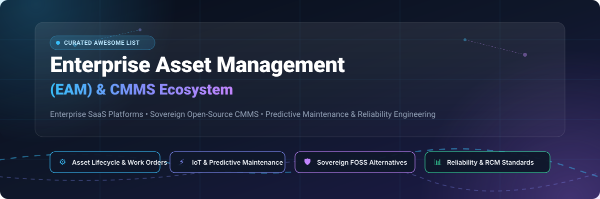
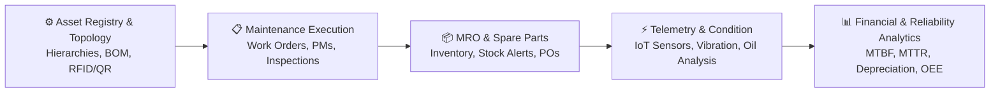

# 🛠️ Awesome Enterprise Asset Management (EAM) & CMMS Ecosystem

<p align="center">
  
</p>

<p align="center">
  <a href="https://github.com/ishandutta2007/Awesome-Awesome-Awesome"></a>
  <a href="https://discord.gg/jc4xtF58Ve"></a>
  <a href="https://github.com/ishandutta2007/Awesome-Enterprise-Asset-Management-EAM/stargazers"></a>
  <a href="https://github.com/ishandutta2007/Awesome-Enterprise-Asset-Management-EAM/network/members"></a>
  <a href="https://github.com/ishandutta2007/Awesome-Enterprise-Asset-Management-EAM/issues"></a>
  <a href="https://github.com/ishandutta2007/Awesome-Enterprise-Asset-Management-EAM/blob/main/LICENSE"></a>
  <a href="https://github.com/ishandutta2007"></a>
</p>

---

## 📖 Overview & SEO Guide

Welcome to the definitive **Enterprise Asset Management (EAM)** and **Computerized Maintenance Management System (CMMS)** ecosystem index. This curated repository provides a technical and market-level breakdown of premier **cloud SaaS platforms** and sovereign **open-source (FOSS) software** for asset lifecycle tracking, maintenance operations, predictive analytics, and reliability engineering.

Whether managing industrial plant machinery, distributed fleet infrastructure, linear utilities (pipelines, power grids), data center equipment, or enterprise IT physical assets, this guide covers tools that optimize **Mean Time Between Failures (MTBF)**, reduce **Mean Time to Repair (MTTR)**, enforce **ISO 55000 / SAE JA1012** reliability standards, and maximize asset Return on Investment (ROI).

---

## 📑 Table of Contents

- [📊 Sector Overview & Market Dynamics](#-sector-overview--market-dynamics)
- [☁️ Enterprise SaaS & Hosted EAM Platforms](#️-enterprise-saas--hosted-eam-platforms)
- [💻 Open-Source & Self-Hosted EAM / CMMS Projects](#-open-source--self-hosted-eam--cmms-projects)
- [📐 Architecture & Core Capability Pillars](#-architecture--core-capability-pillars)
- [🤝 How to Contribute](#-how-to-contribute)
- [⚖️ Disclaimer & Compliance](#️-disclaimer--compliance)
- [⭐ Star History](#-star-history)
- [💖 Support & Sponsoring](#-support--sponsoring)

---

## 📊 Sector Overview & Market Dynamics

The global **Enterprise Asset Management (EAM) and CMMS market** is estimated at **$4.8 billion in 2024–2025** and is projected to surpass **$8.5 billion by 2030–2032**, expanding at a compound annual growth rate (**CAGR of 10.2%–11.5%**), driven by rapid industrial IoT (IIoT) sensor adoption, AI-powered predictive maintenance, and strict ESG compliance mandates.

The sector is **moderately fragmented**: 
- **Concentrated Enterprise Tier:** Mission-critical asset management in heavy asset-intensive sectors (oil & gas, defense, aerospace, utilities, and large-scale manufacturing) is largely dominated by established ERP/EAM monoliths (**Oracle**, **SAP**, **IBM Maximo**, and **ServiceNow**), which leverage deep integrations with enterprise supply chains and corporate finance.
- **Dynamic Mid-Market & Frontline CMMS:** Rapid fragmentation occurs at the facility, plant, and mobile technician level, where nimble, mobile-first cloud disruptors (**MaintainX**, **UpKeep**, **Fiix**) and extensible open-source platforms compete aggressively to eliminate paperwork, accelerate technician workflows, and dismantle expensive per-asset licensing barriers.

---

## ☁️ Enterprise SaaS & Hosted EAM Platforms

The following table benchmarks category-leading Enterprise Asset Management SaaS platforms, **sorted in descending order by parent company scale (market capitalization / valuation & revenue)**. Pricing reflects concrete starting tiers and verified free trial or free-forever plan boundaries.

| 🏢 Platform / Vendor | 📈 Company Scale (Valuation / Revenue) | 💳 Starting Tier Pricing | 🎁 Free Tier / Free Trial Limits | 🛠️ Core Capabilities & Highlights |
| :--- | :--- | :--- | :--- | :--- |
| **[Oracle Fusion Cloud Maintenance](https://www.oracle.com/scm/maintenance/)** | **~$460B Market Cap**<br>*(~$53B Annual Revenue)* | **$150 / user / month**<br>*(Fusion SCM base tier; typical 25-user contract baseline)* | **30-Day Free Trial** with **$300 cloud credits** + Always Free base cloud tier *(no permanent free EAM plan)* | Native integration with Oracle Fusion ERP & Supply Chain; forecast work requirements, interval-based PM scheduling, sensor-driven condition maintenance, and automated material replenishment. |
| **[SAP S/4HANA Asset Management (SAP EAM)](https://www.sap.com/products/scm/asset-management.html)** | **~$260B Market Cap**<br>*(~$34B Annual Revenue)* | **~$110 / fulfiller / month**<br>*(Advanced Use metric; typical enterprise contract min. ~$30k/yr)* | **14- to 30-Day Guided Cloud Trial** with pre-configured maintenance scenarios *(no permanent free tier)* | Closed-loop integration between asset strategy and execution; RCM/FMEA compliance (SAE JA1012), AI-assisted defect inspection via cameras/drones, and barcode scanning for unplanned movements. |
| **[IBM Maximo Application Suite](https://www.ibm.com/products/maximo)** | **~$220B Market Cap**<br>*(~$62.5B Annual Revenue)* | **$3,150 / month base SaaS**<br>*(AppPoints credit model; approx. $180–$220/user/mo equivalent)* | **14-Day Guided Sandbox Trial** with sample industrial data and mobile access *(no permanent free tier)* | Gold standard in heavy industrial EAM; combines EAM, Asset Performance Management (APM), AI image analysis visual inspection, and health scorecards with unified AppPoints licensing. |
| **[ServiceNow Enterprise Asset Management](https://www.servicenow.com/products/enterprise-asset-management.html)** | **~$180B Market Cap**<br>*(~$10.5B Annual Revenue)* | **~$100–$150 / fulfiller / month**<br>*(Requester seats free; min. annual commitments ~$15k–$25k/yr)* | **15-Day Personal Developer Instance (PDI)** for Now platform testing; 30-day enterprise PoC via sales | Full physical asset lifecycle from acquisition through retirement; Enterprise Asset Workspace, linear asset tracking (roads, pipelines), interactive indoor floorplans, and Field Service Management. |
| **[Brightly Asset Essentials](https://www.brightlysoftware.com/)** *(Siemens AG)* | **Parent: ~$165B Market Cap**<br>*(Acquired Brightly for $1.575B)* | **~$45–$95 / user / month**<br>*(Starter facility packages typically start at ~$1,200/mo or $12k/yr)* | **14-Day Guided Sandbox Demo** via qualified sales consultation *(no open self-serve free trial)* | Purpose-built for education, municipal government, and facility management; centralized asset registries, automated work orders, preventive scheduling, and optional Smart Assets IoT telemetry. |
| **[HxGN EAM (formerly Infor EAM)](https://hexagon.com/products/hxgn-eam)** *(Hexagon AB)* | **~$31B Market Cap**<br>*(~$5.5B Annual Revenue)* | **~$100–$150 / user / month**<br>*(Typically 10-user minimum base commitment ~$15,000/yr)* | **14-Day Guided Sandbox / PoC** arranged via sales qualification *(no permanent free tier)* | 30+ years of industrial asset engineering; Constraint Optimizer using ML for complex multi-variable scheduling, Digital Work mobile interfaces, and hybrid cloud/on-premise deployments. |
| **[Fiix CMMS](https://www.rockwellautomation.com/en-us/products/software/fiix.html)** *(Rockwell Automation)* | **Parent: ~$30B Market Cap**<br>*(Acquired Fiix for ~$300M)* | **Free Plan available**<br>*(Paid Basic starts at $45/user/mo; Professional at $75/user/mo)* | **Free Forever Plan** for up to **3 users**, unlimited work orders, basic asset tracking, mobile app, capped at 25 active PMs | Cloud CMMS with AI-driven predictive insights (Fiix Foresight); direct integration with FactoryTalk Optix and industrial PLCs/SCADA for condition-based automated maintenance work orders. |
| **[IFS Cloud EAM](https://www.ifs.com/solutions/enterprise-asset-management)** | **~$11B Valuation**<br>*(EQT backed; ~$1.2B Annual Revenue)* | **~$120–$160 / user / month**<br>*(Annual enterprise contracts starting at ~$25,000/year base)* | **30-Day Enterprise PoC Sandbox** with guided evaluation scenarios *(no permanent free tier)* | Specialized in aerospace, defense, energy, and maritime offshore maintenance; data synchronization across intermittent/unreliable communications, capital project planning, and service dispatch. |
| **[MaintainX](https://www.maintainx.com/)** | **~$1.0B Valuation**<br>*(Series C Unicorn; ~$70M+ ARR)* | **Free Plan available**<br>*(Essential starts at $19/user/mo; Premium at $49/user/mo billed annually)* | **Free Forever Basic Plan**: unlimited requesters, unlimited work orders, capped at 2 repeating PMs, 2 procedure WOs, 1-mo analytics | Mobile-first frontline maintenance; real-time in-app technician chat, conditional procedure logic, digital safety audits, QR/barcode scanning, and parts inventory threshold alerts. |
| **[UpKeep CMMS](https://upkeep.com/)** | **~$400M Valuation**<br>*(Series C; ~$35M+ ARR)* | **$24 / user / month**<br>*(Essential plan; Premium at $55/user/mo; requesters & view-only seats free)* | **7-Day Full-Access Free Trial** with unlimited invited team members and full Professional features *(no permanent free tier)* | Mobile-first CMMS featuring the Nova AI assistant for automated data cleanup, voice-to-work-order creation, automated parts inventory tracking, and IoT vibration sensor integrations. |

---

## 💻 Open-Source & Self-Hosted EAM / CMMS Projects

Sovereign open-source solutions allow organizations to build tailored asset tracking, preventive maintenance, and work order infrastructure without per-user licensing fees or data lock-in. 

The projects below are **sorted in descending order by GitHub_Stars_Count**:

1. **[ERPNext (Asset & Maintenance Module)](https://github.com/frappe/erpnext)** [](https://github.com/frappe/erpnext/stargazers)  
   *Comprehensive Open-Source Enterprise Resource Planning (ERP)*  
   Features a battle-tested **Asset Management & Maintenance** module covering end-to-end fixed asset lifecycles: capital acquisition, automated straight-line and double-declining depreciation calculations, asset maintenance visits, recurring maintenance schedules, work order costing, and insurance tracking. Built on Python Frappe and MariaDB.  
   `License: GPL-3.0` | `Stack: Python / JavaScript / MariaDB`

2. **[NetBox](https://github.com/netbox-community/netbox)** [](https://github.com/netbox-community/netbox/stargazers)  
   *Premier Infrastructure & Physical Asset Source of Truth*  
   The gold standard for physical IT/OT hardware asset management, Data Center Infrastructure Management (DCIM), and IPAM. Models complex physical asset hierarchies, equipment racks, device power distribution (PDUs), linear cable runs, physical device elevations, and multi-tenant site locations.  
   `License: Apache-2.0` | `Stack: Python / Django / PostgreSQL`

3. **[Snipe-IT](https://github.com/grokability/snipe-it)** [](https://github.com/grokability/snipe-it/stargazers)  
   *Open-Source IT & Physical Equipment Asset Management*  
   Widely adopted asset tracker built for managing hardware, machinery, office tools, and consumables. Features rapid check-in/check-out workflows, barcode and QR label printing, digital signature acceptance, asset maintenance logs, warranty tracking, and financial depreciation schedules.  
   `License: AGPL-3.0` | `Stack: PHP / Laravel / MySQL`

4. **[InvenTree](https://github.com/inventree/InvenTree)** [](https://github.com/inventree/InvenTree/stargazers)  
   *Open-Source Inventory, Parts & Equipment Asset Management*  
   Designed for engineering operations, manufacturing assembly, and maintenance workshops. Provides multi-level location hierarchies, batch and serial number tracking, bill of materials (BOM), supplier part catalogs, stock alerts, and companion mobile apps for quick barcode updates.  
   `License: MIT` | `Stack: Python / Django / React`

5. **[GLPI](https://github.com/glpi-project/glpi)** [](https://github.com/glpi-project/glpi/stargazers)  
   *Full-Scale Asset & Service Desk Management System*  
   Mature open-source platform combining ITIL service desk workflows with comprehensive physical asset management. Tracks data center racks, server clusters, network topologies, administrative licenses, maintenance vendor contracts, and scheduled servicing intervals.  
   `License: GPL-3.0` | `Stack: PHP / JavaScript / MariaDB`

6. **[Grash CMMS (Atlas CMMS)](https://github.com/Grashjs/cmms)** [](https://github.com/Grashjs/cmms/stargazers)  
   *Modern Open-Source Self-Hosted CMMS Platform*  
   Feature-complete self-hosted CMMS with web and mobile applications. Includes work order assignment and time-logging, automated preventive maintenance routines, asset downtime histories, spare parts stock alerts, purchase order workflows, and Google Maps geographical asset mapping.  
   `License: GPL-3.0` | `Stack: Java / Spring Boot / React / React Native`

7. **[DataGerry](https://github.com/DataGerry/DataGerry)** [](https://github.com/DataGerry/DataGerry/stargazers)  
   *Flexible Open-Source CMDB & Asset Data Modeling Engine*  
   Allows organizations to model custom physical and digital asset schemas without rigid database constraints. Features custom type builders, relational graph mappings, external system sync bridges, and high-performance REST APIs.  
   `License: Apache-2.0` | `Stack: Python / Angular`

8. **[Odoo EAM Module](https://github.com/codup/odoo-eam)** [](https://github.com/codup/odoo-eam/stargazers)  
   *Enterprise Asset Management Extension for Odoo*  
   Community EAM suite for Odoo environments. Enforces asset hierarchies, work orders, preventive maintenance schedules, meter readings, calibration tracking, and equipment downtime metrics tightly integrated with Odoo Inventory and Accounting.  
   `License: LGPL-3.0` | `Stack: Python / JavaScript / PostgreSQL`

9. **[RemonAlbear CMMS](https://github.com/remonalbear/CMMS)** [](https://github.com/remonalbear/CMMS/stargazers)  
   *Computerized Maintenance Management System Project*  
   Open-source maintenance management system for managing internal maintenance tasks, tracking machine downtime, dispatching corrective repair orders, and managing maintenance technician labor hours.  
   `License: Open Source` | `Stack: PHP / MySQL`

10. **[Maintenance Laravel](https://github.com/liberusoftware/maintenance-laravel)** [](https://github.com/liberusoftware/maintenance-laravel/stargazers)  
    *Laravel & Filament Admin CMMS Application*  
    Modern maintenance management application designed for industrial facilities. Features equipment tracking, scheduled work orders, preventive checklists, technician assignments, and an intuitive Filament-powered admin dashboard.  
    `License: MIT` | `Stack: PHP 8.x / Laravel / Filament`

11. **[SuperCMMS](https://github.com/SuperCMMS/Open-Source-CMMS)** [](https://github.com/SuperCMMS/Open-Source-CMMS/stargazers)  
    *Headless Open-Source CMMS Backend*  
    Backend API engine specifically built so organizations can assemble bespoke maintenance portals and technician apps. Implements asset registries, preventive/predictive work orders, inspection checklists, QR identification, and file attachment storage.  
    `License: AGPL-3.0` | `Stack: TypeScript / Node.js`

12. **[LibreMaint](https://github.com/lowag/libremaint)** [](https://github.com/lowag/libremaint/stargazers)  
    *Lightweight CMMS for Workshop & Plant Maintenance*  
    Focused, no-bloat CMMS for logging maintenance jobs, scheduling recurring equipment servicings, and reviewing historical intervention logs on industrial machines.  
    `License: GPL-3.0` | `Stack: PHP / MySQL`

13. **[CalemEAM Community](https://github.com/calemcme/CalemEAM)** [](https://github.com/calemcme/CalemEAM/stargazers)  
    *Enterprise Asset Management Platform*  
    Commercial open-source EAM providing modular building blocks for multi-site asset tracking, preventive maintenance task chains, work orders, requisition workflows, and role-based operational permissions.  
    `License: GPL-2.0` | `Stack: PHP / JavaScript / MySQL`

14. **[Microsoft Dynamics 365 Asset Management Mobile](https://github.com/microsoft/scmsamples-EnterpriseAssetManagement)** [](https://github.com/microsoft/scmsamples-EnterpriseAssetManagement/stargazers)  
    *Open-Source EAM Mobile Client for Dynamics 365*  
    MIT-licensed source code for Microsoft's Dynamics 365 Supply Chain Asset Management mobile app. Allows enterprise teams to build, customize, and deploy bespoke mobile experiences for field work orders, maintenance requests, and spare part consumption.  
    `License: MIT` | `Stack: TypeScript / React Native`

15. **[GMAO Factory](https://github.com/jsbsan/GMAO-FACTORY)** [](https://github.com/jsbsan/GMAO-FACTORY/stargazers)  
    *Air-Gapped & Offline-First Lightweight CMMS*  
    Offline-capable maintenance manager engineered for isolated workshops and SME facilities. Provides KPI dashboards, spare parts inventories, corrective and preventive maintenance workflows, visual calendar schedules, and local SQLite data persistence.  
    `License: GPL-3.0` | `Stack: Python / Flask / SQLite`

---

## 📐 Architecture & Core Capability Pillars

A robust enterprise asset management deployment combines five architectural pillars:



1. **Hierarchy & Geospatial Mapping**: Ability to model parent-child relationships (Plant ➡️ Line ➡️ Machine ➡️ Subassembly ➡️ Component) and linear assets (pipelines, conveyor belts, electrical transmission lines).
2. **Preventive (PM) & Predictive (PdM) Maintenance**: Time-based intervals, meter-based run hours, and condition-based IoT triggers (vibration, thermal, acoustic anomaly detection).
3. **MRO (Maintenance, Repair, and Operations) Inventory**: Automatic reorder points, spare parts kitting for standard work orders, and vendor purchase requisition workflows.
4. **Safety & Regulatory Compliance**: Permit-to-Work (PTW), Lockout/Tagout (LOTO), OSHA audit trails, and strict revision controls for maintenance SOPs.
5. **Operational Reliability Metrics**: Tracking **OEE (Overall Equipment Effectiveness)**, **MTBF (Mean Time Between Failures)**, **MTTR (Mean Time to Repair)**, and total asset cost of ownership.

---

## 🤝 How to Contribute

Contributions from maintenance professionals, software architects, and reliability engineers are warmly welcomed!

1. 🍴 **Fork the repository** on GitHub.
2. 🌿 **Create a feature branch**:
   ```bash
   git checkout -b feature/add-new-eam-tool
   ```
3. 📝 **Add or update an entry in `README.md`**:
   - Maintain table formatting for SaaS tools (include exact starting pricing and specific free trial terms).
   - For open-source projects, include the official repository link, Stars_Badge (`style=social&color=white`), licensing, and tech stack details.
   - Keep descriptions objective, factual, and focused on core capabilities.
4. 🚀 **Commit your changes and open a Pull Request** with a brief summary of the addition.

---

## ⚖️ Disclaimer & Compliance

- This repository is a community-maintained research index for educational and technical evaluation purposes; it does not constitute commercial endorsement or financial advice.
- EAM and CMMS systems managing physical industrial assets, medical equipment, or power infrastructure must adhere to statutory safety regulations (such as OSHA, EPA, FDA 21 CFR Part 11, and ISO 55001).
- Self-hosted open-source software deployments must verify applicable licensing requirements (e.g., AGPL-3.0 copyleft obligations vs. Apache-2.0 / MIT commercial allowances).
- Listed SaaS pricing tiers and trial terms represent publicly verified data at the time of publication and remain subject to vendor adjustments.

---

## ⭐ Star History

[](https://star-history.dera.page/#ishandutta2007/Awesome-Enterprise-Asset-Management-EAM&type=date&legend=top-left)

---

## 💖 Support & Sponsoring

A huge thank you to everyone exploring, contributing to, and curating this Enterprise Asset Management ecosystem! 🙏

If this curated guide helps your team discover tools, streamline maintenance operations, or deploy self-hosted asset management:
- ⭐ **Star this repository** to help other engineers and facility directors discover it on GitHub.
- 🍴 **Fork the repo** to add your favorite EAM platforms, CMMS engines, or maintenance templates.
- 📢 **Share with colleagues, reliability engineers, and plant managers.**
- ☕ **Support future maintenance and updates:** Feel free to buy a coffee or sponsor via the [GitHub Sponsors Dashboard](https://github.com/sponsors/ishandutta2007).
